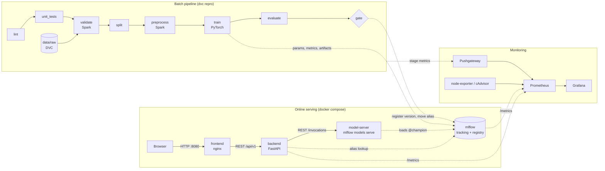

# LeafGuard: Architecture

This document shows the blocks LeafGuard is made of, explains what each one does, and
describes how they connect. Design rationale is in [hld.md](hld.md). Endpoint and I/O
details are in [lld.md](lld.md).

## Diagram: text version

The architecture in plain text, so it can be read in a terminal (`less docs/architecture.md`),
diffed in git and edited without a drawing tool. Arrows point in the direction of the call
or data flow.

```text
                                    LeafGuard - architecture

== Online serving (Docker Compose services, REST only) ================================================

 +--------------------+  HTTP   +------------------------+
 | Browser            |-------->| frontend         :8080 |
 | Check leaf, Help,  |         | nginx: static pages,   |
 | Pipeline console   |         | proxies /api,          |
 +--------------------+         | writes config.js       |
                                +------------------------+
                                             |
                                             | REST /api/v1
                                             |
                                             v
                                +------------------------+    REST      +----------------------------+
                                | backend          :8000 |------------->| model-server       :5001   |
                                | FastAPI gateway:       | /invocations | mlflow models serve        |
                                | validation, errors,    |              | models:/leafguard          |
                                | drift (PSI), encrypted |              |   @champion                |
                                | feedback, pipeline     |              | (pyfunc + TorchScript)     |
                                | views, /metrics        |              +----------------------------+
                                +------------------------+                             ^
                                             |                                         |
                                             |                                         | loads @champion
                                             |                                         |
                                             | alias lookup,                           |
                                             | version list                            |
                                             |                          +----------------------------+
                                             |                          | mlflow             :5000   |
                                             +------------------------->| tracking server +          |
                                                                        | model registry             |
                                                                        | (champion / challenger)    |
                                                                        +----------------------------+
                                                      train / gate: log runs, register, set alias  ^
                                                                                                   |
== Batch pipeline: `dvc repro` in the project venv (the DVC DAG is the CI) ========================|===
                                                                                                   |
 +-------------------+    +-------------------+    +-------------------+    +-------------------+  |
 | lint              |--->| unit_tests        |--->| validate          |--->| split             |  |
 | ruff, black       |    | pytest + coverage |    | Apache Spark      |    | stratified        |  |
 +-------------------+    +-------------------+    +-------------------+    +-------------------+  |
                                                                                      |            |
                                                                                      |            |
           +--------------------------------------------------------------------------+            |
           v                                                                                       |
 +-------------------+    +-------------------+    +-------------------+    +-------------------+  |
 | preprocess        |--->| train             |--->| evaluate          |--->| gate              |  |
 | Spark resize +    |    | PyTorch +         |    | golden test set   |    | register,         |--+
 | drift baseline    |    | MLflow logging    |    |                   |    | promote           |
 +-------------------+    +-------------------+    +-------------------+    +-------------------+

 data/raw (DVC, local remote) -> data/interim -> data/processed -> models/
 reports/*.json -> Pipeline console          every stage -> Pushgateway (below)
                |
                | push stage metrics
                |
== Monitoring ==|======================================================================================
                |   Prometheus also scrapes backend /metrics and mlflow /metrics (above).
                v                                                         PromQL
 +------------------------------+  scrape +-------------------------------+    +----------------------+
 | Pushgateway            :9091 |-------->| Prometheus           :9090    |--->| Grafana        :3000 |
 | stage duration, throughput,  |         | scrapes every 5 s             |    | your own instance:   |
 | status, champion accuracy    |    +--->| 6 alert rules: drift, errors, |    | LeafGuard dashboard  |
 +------------------------------+    |    | latency, uncertain answers,   |    | (20 panels + alerts) |
                                     |    | target down, stage failed     |    +----------------------+
                                     |    +-------------------------------+
 +------------------------------+    |
 | node-exporter, cAdvisor      |----+
 | host CPU / memory and        |
 | per-container resources      |
 +------------------------------+
```

## Diagram: Mermaid version

GitHub and VS Code (Markdown preview) render this one as a diagram.




## Blocks

### Online serving: five containers, connected only over REST

| Block | Technology | Responsibility | Talks to |
|---|---|---|---|
| **Browser UI** | HTML, CSS, vanilla JS | Two audiences, separate screens. Farmer screens: *Check leaf* (one large Upload photo button, the answer as one coloured label: green Healthy, red Disease found, yellow Not sure; Yes / No feedback) and *Help* (colour key and short manual). Operator screen: *Pipeline console* (stage status, gate decision, model versions, data quality, throughput, DAG, filterable run history with success/failure tally, links to the MLOps tools), reached from the footer. Validates file type and size before uploading. | frontend only |
| **frontend** | nginx (alpine) | Serves the static pages. Proxies `/api/*` to the backend, so the browser never needs to know where the backend is. Writes `config.js` from environment variables at startup, which sets the API base path and the tool ports. | backend (`BACKEND_HOST:BACKEND_PORT`) |
| **backend** | FastAPI, Python 3.12 | The API gateway. It validates uploads, calls the model server and turns raw scores into a user-facing answer (including the *uncertain* state). It also computes input drift (PSI), stores corrections with Fernet encryption, serves pipeline reports to the console, and exposes Prometheus metrics. **It never loads the model.** | model-server (`MODEL_SERVER_URL`), mlflow (`MLFLOW_TRACKING_URI`) |
| **model-server** | `mlflow models serve`, PyTorch CPU | Serves `models:/leafguard@champion` as a REST API (`/invocations`, `/ping`). The model is an MLflow pyfunc that decodes, resizes, normalises and classifies, so the preprocessing ships inside the model. | mlflow (download the model) |
| **mlflow** | MLflow 3.17 tracking server | Experiment tracking (SQLite backend), artifact store (proxied), and the model registry with `champion` / `challenger` aliases. Exposes `/metrics`. | none |

### Batch pipeline: DVC stages run in the project's virtual environment

| Stage | Technology | Input | Output |
|---|---|---|---|
| `lint` | ruff, black | source code | `reports/lint.txt` |
| `unit_tests` | pytest, pytest-cov, pytest-html | source, `tests/unit` | `reports/junit.xml`, `coverage.xml`, `tests.html`, `ci_gate.json` |
| `validate` | **Apache Spark** (`binaryFile` + `mapInPandas`) | `data/raw` (DVC-tracked) | `data/interim/manifest.parquet`, `reports/data_quality.json` |
| `split` | pandas | manifest | `data/interim/splits.parquet`, `reports/split_summary.json` |
| `preprocess` | **Apache Spark** | splits | `data/processed/`, `models/baseline.json` (drift reference), `reports/throughput.json` |
| `train` | PyTorch, torchvision, **MLflow** | processed images | `models/model.pt` (TorchScript), `classes.json`, `run.json` |
| `evaluate` | scikit-learn, matplotlib | model, golden test set | `reports/metrics.json`, `confusion_matrix.png` |
| `gate` | MLflow registry | metrics, model | new registered version, alias decision, `reports/gate.json` |

Each stage is wrapped in `track_stage`, which appends a record to
`reports/pipeline_runs.jsonl` and pushes duration, item count, throughput and status to
the Pushgateway. The Pipeline console reads the first and Grafana reads the second.

### Monitoring

| Block | What it watches |
|---|---|
| **Prometheus** | Scrapes the backend, MLflow, Pushgateway, node-exporter, cAdvisor and itself every 5 s. Evaluates the alert rules in `monitoring/prometheus/alerts.yml`. |
| **Pushgateway** | Holds the batch pipeline's stage metrics and the champion's accuracy. Batch jobs cannot be scraped while they run. |
| **node-exporter / cAdvisor** | CPU and memory of the host, and of each container. |
| **Grafana** | The existing Grafana instance. `make up` attaches it to the compose network; the Prometheus data source (`http://prometheus:9090`) and the versioned LeafGuard dashboard are added in Grafana's UI. The dashboard has 20 panels in 4 rows (service, model behaviour, pipeline, infrastructure) plus a firing-alerts table. |

### Storage and versioning

| What | Where | Versioned by |
|---|---|---|
| Source code, configs, dashboards, docs | repository | Git |
| Raw dataset | `data/raw` | DVC (`data/raw.dvc`, local remote) |
| Intermediate data, processed images, model files | `data/interim`, `data/processed`, `models/` | DVC pipeline outputs (`dvc.lock`) |
| Runs, metrics, model versions | MLflow (Docker volume `mlflow-data`) | MLflow run id + registry version |
| User corrections | `data/feedback` | Encrypted at rest (Fernet) |

## Ports

| Service | Port | Purpose |
|---|---|---|
| frontend | 8080 | The application |
| backend | 8000 | REST API, Swagger at `/docs` |
| model-server | 5001 | MLflow model REST API |
| mlflow | 5000 | Tracking UI and registry |
| prometheus | 9090 | Metrics, targets, alerts |
| pushgateway | 9091 | Batch metrics |
| grafana | 3000 | Dashboards (existing instance) |

All published ports are configurable in `.env`.
